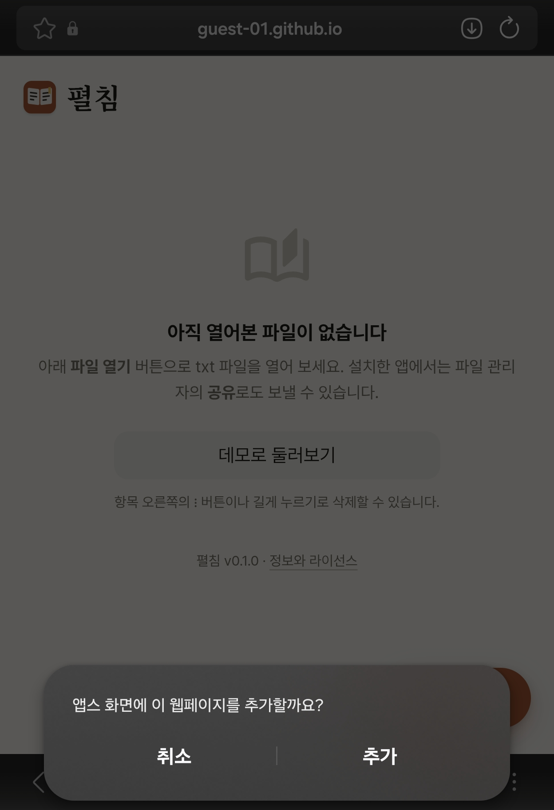
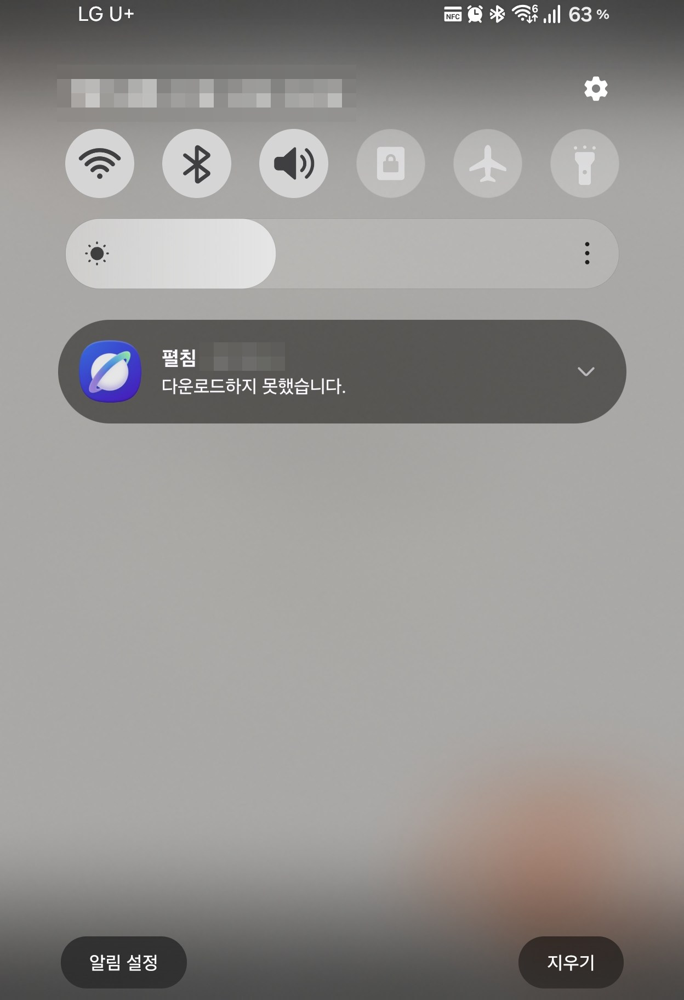
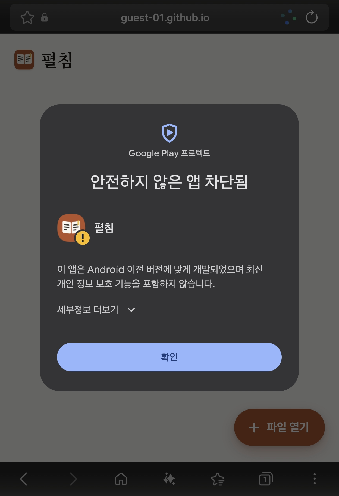
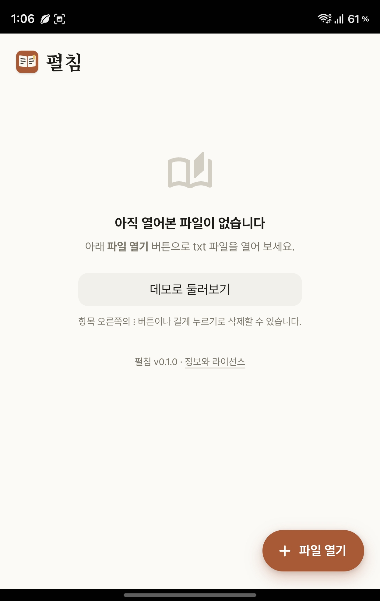
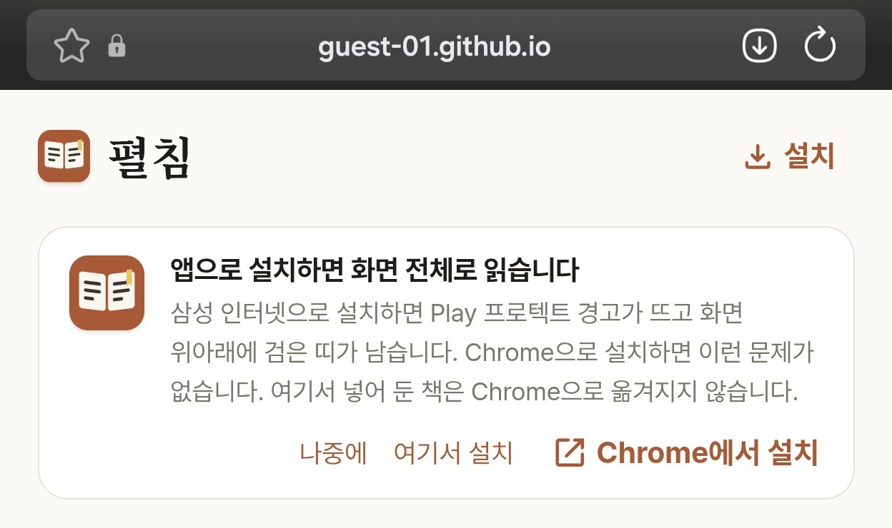
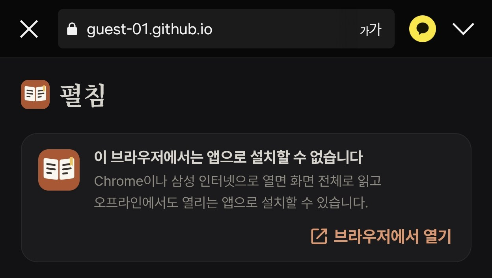

> 이 글은 AI와 함께 작성했습니다.

최근에 [펼침](https://github.com/Guest-01/text-viewer-pwa)이라는 모바일 txt 뷰어를 PWA로 만들었습니다. 앱 스토어를 거치지 않고 브라우저에서 바로 설치해서, 홈 화면 아이콘으로 열고 오프라인에서도 쓰는 것이 목표였습니다.

처음부터 기준으로 삼은 브라우저는 삼성 인터넷이었습니다. 국내 안드로이드 스마트폰은 대부분 삼성 갤럭시이고, 갤럭시의 기본 브라우저인 삼성 인터넷을 그대로 쓰는 사람이 많기 때문입니다. 삼성 인터넷에서 잘 설치되고 잘 돌아가면 충분하다고 생각했고, Chrome은 고려 대상도 아니었습니다.

그런데 결국 **Chrome으로 설치하도록 안내하게** 됐습니다. 이 글은 그 과정을 정리한 것입니다.

이 글의 내용은 2026년 9월 기준입니다. 브라우저 쪽 문제는 언제든 고쳐질 수 있으니 시점을 감안하고 읽어주세요. 글에 실은 코드는 설명을 위해 실제 코드를 조금 줄인 것입니다.

### 목표

펼침에서 PWA로 얻고 싶었던 것은 세 가지입니다.

1. 홈 화면에 설치해 주소창 없이 전체 화면으로 실행
2. 오프라인에서도 동작
3. 파일 관리자에서 txt 파일을 "공유"하면 펼침이 받아서 열기

3번은 [Web Share Target](https://developer.mozilla.org/en-US/docs/Web/Progressive_web_apps/Manifest/Reference/share_target)으로 구현합니다. 매니페스트에 `share_target`을 선언하면 설치된 PWA가 안드로이드의 공유 대상 목록에 나타납니다. 파일을 받아야 하므로 `POST`와 `multipart/form-data`를 씁니다.

```json
{
  "share_target": {
    "action": "./share-target",
    "method": "POST",
    "enctype": "multipart/form-data",
    "params": {
      "title": "title",
      "text": "text",
      "url": "url",
      "files": [
        { "name": "file", "accept": ["text/plain", "text/markdown", ".txt", ".text", ".md", ".log"] }
      ]
    }
  }
}
```

그런데 기준으로 삼은 삼성 인터넷에서 설치부터 막혔습니다.

### 삼성 인터넷에서 설치 실패

삼성 인터넷에서 설치를 누르면 확인 창까지는 정상적으로 뜹니다. 그런데 "추가"를 누르고 나면 **"다운로드하지 못했습니다"**라는 알림과 함께 설치가 실패했습니다.

|              설치 확인 창              |              설치 실패 알림              |
| :------------------------------------: | :--------------------------------------: |
|  |  |

이 알림에는 원인에 대한 정보가 전혀 없습니다. 그래서 증상으로 검색해 보니 삼성 개발자 포럼에 [같은 증상을 다룬 글](https://forum.developer.samsung.com/t/bug-pwa-webapk-installation-fails/7475)이 있었습니다. 2020년에 한 번 고쳐진 문제인데, 2025년 12월에 "다시 깨졌고, 매니페스트에서 `share_target`을 빼면 설치된다"는 댓글이 달려 있었습니다.

실제로 매니페스트에서 `share_target` 블록만 빼고 나머지는 그대로 둔 채 설치해 보니 삼성 인터넷에서도 설치가 됐습니다. 블록 안의 무엇이 문제인지까지는 가려내지 않았습니다.

안드로이드에서 PWA를 "앱처럼" 설치하면 브라우저는 [WebAPK](https://web.dev/learn/pwa/installation)라는 작은 APK를 만들어 설치합니다. 이 APK는 기기에서 만들어지는 것이 아니라 브라우저 제조사의 서버가 매니페스트를 읽어 만들어 주는데, 삼성 인터넷은 Chrome과 별개로 자체 서버를 씁니다. 그래서 같은 매니페스트라도 브라우저에 따라 결과가 다를 수 있고, 실제로 `share_target`이 들어 있는 원래 매니페스트도 Chrome에서는 문제없이 설치됩니다. 매니페스트가 잘못된 것이 아니라 삼성 인터넷 쪽의 문제로 보입니다.

### 삼성 인터넷에만 다른 매니페스트 주기

`share_target`만 빼면 설치가 된다면, 삼성 인터넷에만 그것을 뺀 매니페스트를 주면 됩니다. `share_target`을 제외하고는 내용이 완전히 같은 `manifest-samsung.webmanifest`를 하나 더 만들고, `<head>`에서 User-Agent를 보고 바꿔줍니다.

```html
<link rel="manifest" id="manifest-link" href="./manifest.webmanifest">
<script>
  // 삼성 인터넷에만 share_target을 뺀 매니페스트를 연결한다
  if (/SamsungBrowser/i.test(navigator.userAgent)) {
    document.getElementById('manifest-link').href = './manifest-samsung.webmanifest';
    document.documentElement.classList.add('no-share');
  }
</script>
```

브라우저가 매니페스트를 읽기 전에 바꿔야 하므로 `<link>` 바로 아래의 인라인 스크립트로 넣었습니다. `no-share` 클래스는 삼성 인터넷으로 설치한 앱에서는 쓸 수 없는 "공유로 파일 받기" 안내 문구를 숨기는 데 씁니다.

### 설치 후에도 남는 문제

이제 삼성 인터넷에서도 설치가 됩니다. 하지만 설치 과정과 설치 후의 모습에서 문제가 두 가지 더 나왔습니다.

첫번째는 Play 프로텍트가 설치를 막는 문제입니다. Android 14 이상에서 삼성 인터넷으로 설치하면 "안전하지 않은 앱 차단됨" 경고가 뜹니다. 경고 문구를 보면 삼성 인터넷이 만드는 WebAPK의 `targetSdk`가 낮아서 오래된 안드로이드 버전용 앱으로 취급되는 것 같습니다. "세부정보 더보기"를 눌러 "무시하고 설치"로 통과할 수는 있지만, 처음 보는 사용자에게 "안전하지 않은 앱"이라는 경고를 넘기라고 할 수는 없습니다. 삼성 인터넷 저장소에도 [같은 문제가 보고](https://github.com/SamsungInternet/support/issues/123)되어 있습니다.

두번째는 화면 위아래에 검은 띠가 남는 문제입니다. 설치한 앱을 열면 상태 바와 하단 제스처 핸들 영역이 검게 남아, 전체 화면으로 책만 보이게 하려던 의도와 달라집니다.

|            Play 프로텍트 경고            |            위아래의 검은 띠            |
| :--------------------------------------: | :------------------------------------: |
|  |  |

두 가지 모두 같은 앱을 Chrome으로 설치하면 생기지 않습니다. 브라우저가 앱을 설치해 주는 방식에서 생기는 문제로 보여서, 웹 앱의 코드로는 고칠 방법을 찾지 못했습니다. 여기에 공유로 파일 받기가 빠진 것까지 더하면, 삼성 인터넷으로 설치한 펼침은 처음 목표했던 세 가지 중 하나가 빠지고 나머지도 온전하지 않게 됩니다.

### Chrome에서 설치하도록 안내하기

그래서 방향을 바꿨습니다. 삼성 인터넷을 기준으로 시작했지만, 여기서 설치가 "되게" 만드는 데서 멈추지 않고 **Chrome에서 설치하도록 권하기로** 했습니다.

결정을 도운 근거가 하나 더 있습니다. 삼성 인터넷은 모든 안드로이드 기기에 있는 것이 아니지만, Chrome은 갤럭시를 포함해 거의 모든 안드로이드 기기에 기본으로 설치되어 있습니다. 삼성 인터넷을 기준으로 삼은 이유가 "많은 사람이 쓰고 있어서"였는데, 이미 설치되어 있는지로 따지면 Chrome 쪽이 더 넓습니다. 새 앱을 깔라고 하는 것이 아니라 이미 있는 브라우저로 열라고 하는 것입니다.

삼성 인터넷으로 접속하면 설치 안내 카드의 내용이 달라집니다. 삼성 인터넷으로 설치할 때의 문제를 알리고, **Chrome에서 설치**를 주 버튼으로, "여기서 설치"를 보조 버튼으로 둡니다.



삼성 인터넷으로 설치하는 것을 막지는 않았습니다. 문제를 알고도 삼성 인터넷을 쓰고 싶은 사람은 "여기서 설치"를 누르면 됩니다.

"Chrome에서 설치" 버튼은 안드로이드의 `intent://` 주소로 현재 페이지를 Chrome에서 엽니다.

```js
// Android에서 target을 Chrome으로 여는 intent 주소
function chromeIntentUrl(target) {
  const u = new URL(target);
  return `intent://${u.host}${u.pathname}${u.search}`
    + `#Intent;scheme=${u.protocol.replace(':', '')}`
    + `;package=com.android.chrome`
    + `;S.browser_fallback_url=${encodeURIComponent(target)};end`;
}

installChromeButton.addEventListener('click', () => {
  location.href = chromeIntentUrl(new URL('./', location.href).href);
});
```

`package=com.android.chrome`으로 여는 앱을 Chrome으로 지정하고, `S.browser_fallback_url`에는 Chrome이 없을 때 대신 열 주소를 넣습니다. 이 주소는 사용자가 버튼을 누른 동작 안에서만 동작하므로, 페이지가 뜨자마자 자동으로 보내는 식으로는 쓸 수 없습니다.

### 인앱 브라우저

Chrome으로 안내하기로 정하고 나니 신경 써야 할 곳이 하나 더 있었습니다. 펼침의 링크를 카카오톡으로 받은 사람은 카카오톡 안의 브라우저로 페이지를 열게 됩니다.

카카오톡, 라인, 네이버, 인스타그램 같은 앱의 인앱 브라우저에서는 PWA를 설치할 수 없습니다. 설치가 가능할 때 브라우저가 보내는 `beforeinstallprompt` 이벤트가 오지 않아 설치 안내 카드도 뜨지 않으므로, 사용자는 설치할 수 있다는 사실조차 모르고 지나갑니다. 그래서 User-Agent로 인앱 브라우저를 감지하면 설치 카드 대신 **브라우저에서 열기** 버튼을 보여주기로 했습니다.



인앱 브라우저에서 외부 브라우저로 내보내는 방법은 이미 알려진 것들이 있습니다.

- 카카오톡: `kakaotalk://web/openExternal?url=...` 스킴으로 엽니다. 비공식이지만 널리 쓰입니다.
- 라인: 주소에 `openExternalBrowser=1` 파라미터를 붙입니다. 공식 방법입니다.

그런데 두 방법 모두 기기의 **기본 브라우저**로 열어 줍니다. 삼성 기기의 기본 브라우저는 삼성 인터넷이므로, 카카오톡에서 넘어온 사용자는 결국 앞에서 본 문제들이 있는 삼성 인터넷으로 가게 됩니다.

그래서 안드로이드에서는 어느 인앱 브라우저든 앞에서 만든 **Chrome intent를 먼저 시도**합니다. 1.5초가 지나도 페이지가 그대로 보이고 있으면 막힌 것으로 보고 앱별 방법으로 넘어가고, 그것도 안 되면 주소를 복사해 두고 브라우저 주소창에 붙여넣도록 안내합니다.

페이지가 뜨자마자 자동으로 내보내지는 않았습니다. 공유된 링크를 잠깐 보려던 사람을 다른 앱으로 보내 버리고 싶지 않았기 때문입니다.

### 남은 한계

이렇게 정리하고도 해결하지 못한 것들이 있습니다.

- **삼성 인터넷과 Chrome은 저장소가 분리되어 있습니다.** 펼침은 책을 서버가 아니라 브라우저의 IndexedDB에 저장합니다. 삼성 인터넷 탭에서 넣어 둔 책은 Chrome으로 설치한 앱에서 보이지 않습니다. 그래서 안내 카드에 "여기서 넣어 둔 책은 Chrome으로 옮겨지지 않습니다"라는 문장을 넣었습니다.
- **iOS의 일반적인 인앱 브라우저에는 외부 브라우저로 내보낼 방법이 없습니다.** 카카오톡과 라인을 제외하면 주소를 복사해 붙여넣게 하거나 "다른 브라우저로 열기" 메뉴를 안내하는 것이 전부입니다.
- **Chrome이 없는 기기도 있습니다.** 이 경우에는 앱별 방법으로 기본 브라우저를 열고, 삼성 인터넷이라면 "여기서 설치"로 설치할 수 있습니다.

### 마치며

정리하면, 안드로이드에서 PWA의 설치 경로는 이렇게 됐습니다.

| 접속한 브라우저 | 안내 |
|---|---|
| Chrome | 그대로 설치 |
| 삼성 인터넷 | Chrome에서 설치를 권하고, 여기서 설치는 보조로 남김 |
| 인앱 브라우저 | Chrome으로 열기를 먼저 시도하고, 안 되면 기본 브라우저, 그것도 안 되면 주소 붙여넣기 |

처음에는 삼성 인터넷에서 설치가 안 되는 문제 하나만 고치면 될 줄 알았는데, 고치고 나서도 Play 프로텍트 경고나 검은 띠 같은 문제가 계속 나와서 결국 Chrome으로 안내하는 쪽으로 바꾸게 되었습니다.

혹시 국내 안드로이드 사용자를 대상으로 PWA를 만들 계획이 있다면, 삼성 인터넷과 Chrome, 카카오톡 인앱 브라우저에서 각각 설치를 직접 해보시는 것을 추천드립니다.
